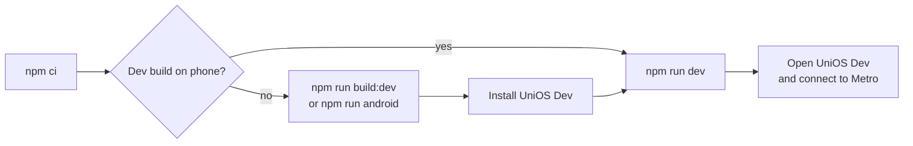

# UniOS

UniOS is an Android app for university students. It keeps your timetable, attendance, tasks and study files on your phone.

It was built for B.Tech students at DCRUST, Murthal. Its attendance rules follow the DCRUST B.Tech Ordinance 2024-25, clause 9. Students at other universities can use it, but the attendance rules may not match theirs.

**Status:** pre-release. There is no store listing and no published release yet. See [Release status](#release-status).

## The problem

DCRUST requires 75% attendance in each subject, counted over lectures, tutorials and labs together. Leave counts as held but not attended, and it can only be condoned later on documents. A student who wants to know "can I miss the next class?" must do this arithmetic for every subject.

UniOS does the arithmetic from your own marks. Its Today tab shows the next class, alerts, the week and task countdowns. Each course shows how many classes you can miss, or must attend, to reach your target. Cancelled, moved and extra classes update the counts.

## Screenshots

No device screenshots are in the repository yet. These screens still need capture on a real Android device:

| Screen | Route |
| --- | --- |
| Today | `app/(main)/today.tsx` |
| Timetable (week view) | `app/(main)/schedule.tsx` |
| Attendance overview and mark sheet | `app/attendance/index.tsx`, `app/attendance/mark.tsx` |
| Course page | `app/course/[id].tsx` |
| AI timetable scan review | `app/course/ai-setup.tsx` |
| File viewer (PDF) | `app/resource/viewer.tsx` |

## Features

"Tested" means the logic has automated tests in `__tests__/`. No feature in this list has a recorded test on a real device. See [Known limitations](#known-limitations).

| Feature | What it does | Status | Evidence |
| --- | --- | --- | --- |
| Attendance | Mark each class present, absent, leave or off. Percentage = present ÷ (present + absent + leave). A 2-hour lab counts as one class. | Tested | `domains/academic/logic.ts`, `__tests__/academic_logic.test.ts`, `__tests__/attendance_property.test.ts` |
| Skip budget | Shows how many classes you can miss and stay at your target, or how many you must attend to get back to it. | Tested | `canSkip`, `mustAttend` in `domains/academic/logic.ts` |
| Leave warning | Leave counts as held but not attended. The app never shows leave as safe. | Tested | `leaveNote` in `domains/academic/logic.ts` |
| Timetable | Weekly classes per course: lectures, tutorials and labs. | Tested | `__tests__/e2e_timetable.test.ts`, `__tests__/course_setup_lineage.test.ts` |
| Schedule changes | Cancel or move one class, add an extra class, take a day off, or follow another weekday's timetable. Marks are kept and come back when you undo a change. | Tested | `domains/calendar/`, `__tests__/schedule_marks.test.ts`, `__tests__/break_it.test.ts` |
| AI timetable scan (optional) | Reads a photo of a printed timetable with Google Gemini. You review every class before it is saved. Needs your own Gemini API key. | Tested (reply checks only) | `domains/timetable/scan.ts`, `__tests__/timetable_scan.test.ts`. The Gemini call itself has no automated test. |
| Tasks | Assignments, exams and personal tasks, with or without a course. | Tested | `__tests__/task_repository.test.ts`, `__tests__/task_form.test.ts` |
| Notes | Markdown notes, with or without a course. | Tested (renderer) | `components/files/MarkdownBody.tsx`, `__tests__/markdown_viewer.test.ts` |
| Study files | Add files, photos and links per course. Identical uploads share one copy. | Tested | `domains/resource/`, `__tests__/add_files.test.ts`, `__tests__/add_job.test.ts` |
| File viewers | In-app viewers for PDF, images, video, audio, text, code, Markdown, Word (.docx), Excel (.xlsx), CSV and PowerPoint (.pptx). Other types open in another app. | Tested (parsers) | `domains/resource/office.ts`, `__tests__/office_readers.test.ts`, `__tests__/viewer_rules.test.ts` |
| Search | Local search over courses, tasks, file names and note text. | Tested | `__tests__/search.test.ts` |
| Backup and restore | Export the database as one JSON file. Restore replaces what is on the phone. | Tested | `core/db/backup.ts`, `__tests__/backup_compat.test.ts`, `__tests__/backup_restore_property.test.ts` |
| Portal attendance snapshot | Shows a saved snapshot of the college portal's attendance next to your own log. | Partial | The app shows snapshots (`domains/academic/snapshot.ts:107`), but no screen creates one. Rows arrive only through a backup restore. |
| Report a problem | Sends a report with app diagnostics to the developer through Sentry. | Implemented | `app/settings/report.tsx`, `core/diagnostics/index.ts` |

### Removed

The earlier "local AI tutor" and laptop companion were removed on 2026-10-14 in commit `8b38196`. They are not part of the app. Some empty database tables from that work remain; see [`docs/architecture/ERD.md`](docs/architecture/ERD.md).

## Release status

| Item | State |
| --- | --- |
| Platform | Android. iOS has no bundle identifier in `app.json`, and the repository has no record of an iOS build. |
| Version | `1.1.0` (`app.json`) |
| Store listing | None linked from this repository |
| GitHub release | None |
| Device testing | Not recorded for the current commit |

Do not treat UniOS as production-ready. Export a backup often.

## Prerequisites

| Tool | Version | Why |
| --- | --- | --- |
| Node.js | 20.19.4 or later, 22.13.0 or later, or 24.3.0 or later | React Native 0.85 requires one of these (`node_modules/react-native/package.json`, `engines`). CI uses Node 22. |
| npm | Comes with Node | The repository has a `package-lock.json`. |
| Android phone or emulator | Android | The app target. |
| Expo account and EAS CLI | Current | Only to build the app in the cloud (`npm run build:dev`). |
| Android Studio and JDK | Current | Only to build the app on your own computer (`npm run android`). |

## Install and run

### Why you need a development build

UniOS uses native libraries that the Expo Go app does not include, for example `react-native-pdf`, `react-native-blob-util` and `expo-dev-client`. Expo's documentation says that a package with native code that Expo Go does not already include cannot run in Expo Go. **Do not use Expo Go.**

Use a development build instead. It is your own debug build of UniOS, named "UniOS Dev" (package `com.anonymous.UniOS.dev`). It installs next to the normal app and does not touch its data. `app.config.js` and `eas.json` define the variants.

### Steps



1. Install dependencies:
   ```bash
   npm ci
   ```
2. Get a development build onto your phone. Do this once, and again after any change to native dependencies.
   - In the cloud, with an Expo account: `npm run build:dev`. Then install the APK that EAS gives you.
   - Or on your own computer, with Android Studio: `npm run android`.
3. Start Metro, the JavaScript server:
   ```bash
   npm run dev
   ```
4. Open "UniOS Dev" on the phone and connect it to Metro.

### Web

Web is not a supported target. `npm run web` exists, but `react-dom` and `react-native-web` are not dependencies (`package.json`, `package-lock.json`). On a clean `npm ci`, `npx expo export -p web` stops with "It looks like you're trying to use web support but don't have the required dependencies installed" (checked 2026-10-17).

### Troubleshooting

| Problem | Fix |
| --- | --- |
| `Unable to load script` on the phone | The dev build cannot reach Metro. Run `npm run dev`. With USB, run `adb reverse tcp:8081 tcp:8081`. |
| A native module is missing or undefined | The dev build is older than the native dependencies. Build it again (`npm run build:dev`). |
| You want to see the app's logs | `npm run logs:android` (needs `adb` and USB debugging). |
| Other checks | `npm run doctor` runs `expo-doctor`. |

More detail is in [`docs/DEBUGGING.md`](docs/DEBUGGING.md).

## Development and tests

| Task | Command |
| --- | --- |
| Typecheck and all tests (run before every commit) | `npm run check` |
| Tests only | `npm test` |
| Typecheck only | `npm run typecheck` |
| Metro for the dev build | `npm run dev` |
| Android logs over USB | `npm run logs:android` |
| Build the dev client APK (EAS) | `npm run build:dev` |
| Build the standalone APK (EAS) | `npm run build:preview` |

The tests are written for Jest with ts-jest. Database tests run on `better-sqlite3`, with the real migrations from `drizzle/`. GitHub Actions runs `npm run check` on each push and pull request (`.github/workflows/check.yml`).

Rules that contributors must know are in [`AGENTS.md`](AGENTS.md).

## Privacy and external services

Your academic data stays on the phone in SQLite. UniOS has no account, no server of its own and no cloud sync. Two features send data off the phone:

| Service | What leaves the phone | When |
| --- | --- | --- |
| Google Gemini (optional) | The timetable photo you pick, an instruction text, your section and group name, and your API key. | Only when you tap scan, and when you check a new key. Nothing is sent if you have no key. |
| Sentry (crash and error reporting) | Crash and error reports with app and device details, performance traces, and screen recordings of some sessions. Text and images in recordings are masked by default. | Always on, in every build. |

**Gemini.** You create your own key at Google AI Studio. UniOS keeps it in the phone's secure storage (`expo-secure-store`). It is not in backups or logs. Google's Gemini API terms say Google may use what you send to the free tier to improve its products, and that human reviewers may read it. Do not scan a photo that shows private information. Read the current terms at <https://ai.google.dev/terms>.

**Sentry.** The settings are in `app/_layout.tsx`. `sendDefaultPii` is `false`. Production builds send 20% of performance traces (`tracesSampleRate: 0.2`). Screen recordings (session replay) cover 10% of sessions and every session with an error. The masking defaults come from `@sentry/react-native` 7.11.0. **Report a problem** sends your note, an optional email, app and device details, table row counts, and recent warnings and errors from the app's log. It does not read the contents of your records. There is no setting to turn Sentry off.

**Links** open in another app, usually your browser, through `Linking.openURL`. UniOS does not download them.

## Known limitations

- No device test is recorded for the current commit. Automated tests cover logic and the database, not the screens.
- The attendance rules are DCRUST's. Other universities may count leave or labs differently.
- A backup holds database rows only. It does not contain your uploaded files, so restoring on a new phone loses them.
- There is no way to enter a portal attendance snapshot in the app.
- Sentry cannot be turned off.
- Android only. No iOS build is configured or recorded.
- The Android package ID is `com.anonymous.UniOS`. Changing it later makes a new app that cannot update the old one.

## Roadmap

These items are not built. None of them has a date.

| Item | Source |
| --- | --- |
| Edit the weekly slots of an existing course | Open audit item OLD-01 (`audit/2026-10-14-deep-audit.md`) |
| Room field and teacher suggestions in course setup | Open audit item OLD-02 |
| Enter portal attendance in the app, with the student typing their own login in an in-app view | `AGENTS.md`, rule "Portal data is read-only" |
| Device test record for the main flows | `docs/requirements/SRS.md`, UNI-REL-002 |

## Contributing

Read [`CONTRIBUTING.md`](CONTRIBUTING.md). Everyone who takes part follows the [Code of Conduct](CODE_OF_CONDUCT.md).

## Security

Do not report security problems in a public issue. Read [`SECURITY.md`](SECURITY.md).

## License

`LICENSE` has the MIT license text. Its copyright line names 650 Industries, Inc. (Expo). That file is the same, byte for byte, as `node_modules/expo/LICENSE`, and it came with the first commit. The owner is reviewing the copyright line for UniOS's own code. This README will change when that review ends.

## Documentation

| Document | Contents |
| --- | --- |
| [PRD](docs/product/PRD.md) | Product intent, users, scope |
| [SRS](docs/requirements/SRS.md) | Requirements with status |
| [Architecture](docs/architecture/ARCHITECTURE.md) | Components, data flow, privacy boundary |
| [Tech stack](docs/architecture/TECH_STACK.md) | Libraries and commands |
| [ERD](docs/architecture/ERD.md) | Database tables |
| [Source of truth](docs/SOURCE_OF_TRUTH.md) | Which document wins when two disagree |
| [Debugging](docs/DEBUGGING.md) | Dev build, logs, Sentry |
