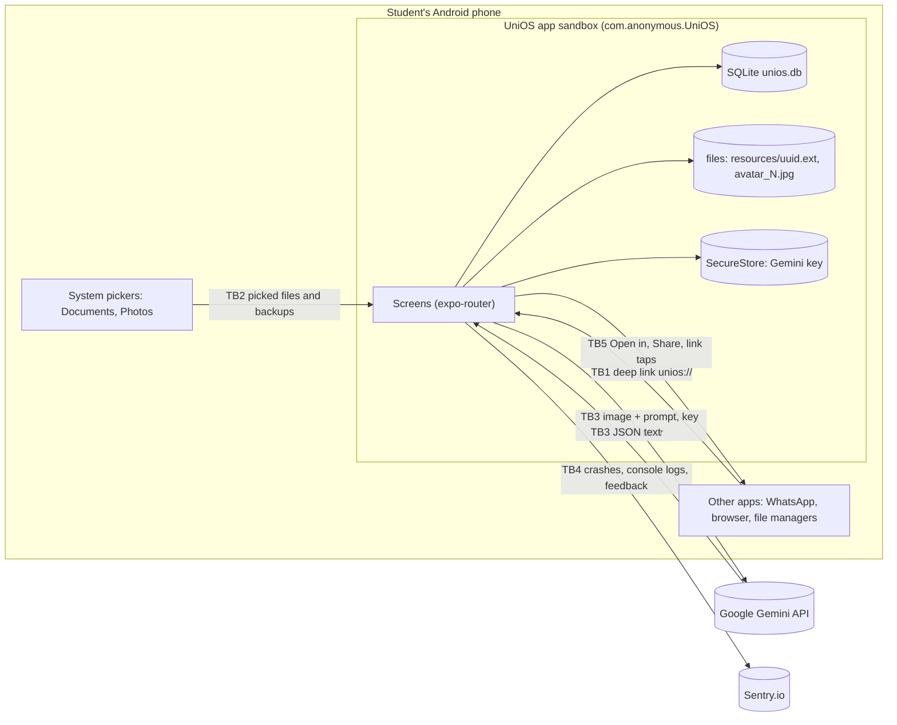

# UniOS deep audit, 2026-10-14

## 1. Header

| Field | Value |
|---|---|
| Repository | `aashu035/UniOS` (local clone `/home/user/UniOS`) |
| Commit / branch | `93e74c49a5b07e616bcd04466ff5445fd062930d` / `claude/tender-brahmagupta-u6o2s9`. `git status`: only `audit/` is untracked. |
| Date | 2026-10-14 |
| Stack | TypeScript. Expo SDK 56, expo-router 56.2.18, React Native 0.85 (Hermes), drizzle-orm 0.45.4 on expo-sqlite, `@sentry/react-native` 7.11.0, `@google/genai` 2.17.1. Jest 29.7.0 with ts-jest. npm 10.9.7 with `package-lock.json`. Node 22.22.2. No server. No login. |
| Auditor model and tool | Claude (Opus 5.5) in Claude Code, cloud session. |
| Scope | All tracked source: `app/`, `components/`, `core/`, `domains/`, `drizzle/`, `scripts/`, `__tests__/`, config files, git history, and the Android bundle built from this commit (`expo export`, source map with 4,575 sources). |
| Out of scope | Behavior on a real phone (no device or emulator here). The Samarth portal (third party). The Sentry and Google back ends. The gitignored audit files on the owner's PC (see Section 11). |

All line numbers use the commit above. No production code, existing test, config file or lockfile was changed. New files are only in `audit/`.

## Status after fixes (2026-10-15)

The report below is unchanged: it describes commit `93e74c4`. This table shows what happened to each Finding afterwards. The audit's own tests were in `audit/adversarial-tests/`. They now live in `__tests__/` (named below), run in `npm run check`, and use the project's `fast-check` dev dependency.

| ID | Status | Fix | Test that proves it |
|---|---|---|---|
| SEC-01 | FIXED | `2ac5d30`: `reconcileMarks` (`domains/calendar/marks.ts`); a mark counts only if its class runs; startup heal | `__tests__/schedule_marks.test.ts` (both reproductions + property test, 150 runs, checked after every step) |
| SEC-06 | FIXED | `2ac5d30`: each day rule and exception change is one `atomic()` call | `schedule_marks.test.ts` › "a day off that fails to save leaves the marks as they were" |
| SEC-02 | FIXED | `clearAllData()` (`core/db/clearData.ts`): every table in one transaction, uploads, photo, Gemini key; DB reset also deletes `-wal`/`-shm` and files | `__tests__/clear_data.test.ts` |
| SEC-03 | FIXED | `components/viewer/markdownParser.ts`: no smart quotes, no linkify; txt/json/csv and files over 200 KB shown as plain text | `__tests__/markdown_viewer.test.ts` (200 KB in ~10 ms) |
| SEC-04 | FIXED | `planImport` checks every field of the model output; prototype keys are not weekdays | `__tests__/import_plan_hostile.test.ts` (incl. 500 random inputs) |
| SEC-05 | FIXED | `app.config.js` `blockedPermissions`; `microphonePermission: false` | `npx expo config --type introspect`: `RECORD_AUDIO(remove)`, `SYSTEM_ALERT_WINDOW(remove)` |
| TEST-01 | FIXED | gate tests moved | `__tests__/name_gates.test.ts` |
| TEST-02 | FIXED | the 4 suites run on real transactions; `phase_b` on the device driver (its tautological test 1 removed) | the suites themselves |
| TEST-05 | FIXED | | `schedule_marks.test.ts` › "input checks" |
| TEST-06 | FIXED | | `break_it.test.ts` checks the row count and that the oldest teacher is used |
| TEST-07 | FIXED | also fixed `resource.name` → `resource.title` in the error text | `__tests__/backup_relational.test.ts` |
| TEST-03, DUP-01 | FIXED | `getCompleteWorkspace` and `getWorkspaceById` removed; the 4 tests now read `CourseOverviewService.getCourseDetail` (the one resolver the app uses) | `forensic_rectification.test.ts` Test 2 and the target check, `course_setup_lineage.test.ts` (2 tests); the empty state now asserts `activeFaculty`/`activeVenue` are `null` and `actualPercentage` is `null` |
| DEAD-01a/b/d/e, DEAD-02, DEAD-05, DEAD-07 | FIXED | Removed, each after a grep showing 0 references in `app/ components/ domains/ core/ __tests__/` (Section "Cleanup, 2026-10-16" below) | `npm run check` (tsc + 379 tests) |
| DEAD-06 | FIXED | `weekday`, `groupPrefix`, the `NotificationType` re-export, `USER_TABLES_CHILD_FIRST` are no longer exported | `npx tsc --noEmit`; knip |
| DUP-02 | OBSOLETE | `app/resource/[id].tsx` was rewritten; no inline link regex remains (`grep -rn "https?:" app/resource` shows only `isWebLink` users) | |
| DUP-03 | FIXED | `TaskService` keeps only `createTask`; the other 6 pass-throughs had 0 callers | `npm run check` |
| CPLX-04 | FIXED (partly) | see DUP-03; `TaskService.createTask` stays because it sends the notification | |
| OLD-03 | FIXED | knip and `grep colors.light` show no screen on the old components; 13 unused old components and 6 unused token files deleted | |
| TEST-04, DUP-04, CPLX-01, CPLX-02, CPLX-03, OLD-01, OLD-02 | OPEN | see "Cleanup, 2026-10-16" | |

## Verification on the current code, 2026-10-16

How to read this report: Sections 2 to 12 describe commit `93e74c4` (2026-10-14) and are not edited. "Status after fixes" and "Cleanup" say what changed afterwards. This section is the only one that is a fresh measurement of the code as it is now.

| Field | Value |
|---|---|
| Commit measured | `482f3be` (`claude/tender-brahmagupta-u6o2s9` = `master`), clean working tree |
| Command | `npm run check` (= `tsc --noEmit && jest`) |
| Result | exit code 0. TypeScript: 0 errors. Jest: **42 suites passed, 0 failed; 379 tests passed, 0 failed, 0 skipped**. Time 27.7 s |
| At `93e74c4` | 22 suites, 220 tests (Section 3) |
| Coverage over all of `domains/` and `core/` | lines 82.6%, branches 76.6% (was 30.5% / 23.8% in Section 3) |

What this proves, and what it does not (rule C3). The tests prove the behaviour they assert: for example `schedule_marks.test.ts` runs 150 random sequences of schedule changes and undos and checks the marks after every step. They do not prove behaviour on a phone. No device or emulator was available, so the camera, system pickers, PDF, video and audio playback, gestures and notifications are **not verified**.

Mutation score was measured at `93e74c4` only (71.79%). It was not re-run on the new modules.

## Cleanup, 2026-10-16

Method: for each candidate, `grep -rnE "\.name\b|\bname\(" app components domains core` (production) and `__tests__` (tests), excluding the definition. A method is removed only when production has 0 references. Knip 5 (`knip --config`, the audit's config) was re-run before and after.

| Removed | Evidence | Why safe |
|---|---|---|
| `WorkspaceRepository`: `count`, `getWorkspaceById`, `getCompleteWorkspace`, `getTimelineEvents`, `addComponentToWorkspace`, `updateComponent`, `updateRecurringSchedule` | 0 production references; the 2 test files that read `getCompleteWorkspace` were ported (ported assertions pass) | One course resolver remains (`CourseOverviewService`) |
| `domains/attendance/service.ts` (whole file) | 0 references anywhere. It held a second attendance write path (`markLocalAttendance`) without the validation, transaction and reconcile of `domains/academic/actions.ts` | A footgun, not a feature: the portal read is done in `snapshot.ts` |
| `AttendanceRepository.getPortalAttendance`, `TaskRepository.getTasksForWorkspace/getPendingTasks`, `NotificationRepository.listUnread` (+ its test), `NotificationService.scheduleException`, `CalendarService.calculateAcademicWeather` (+ 2 interfaces) | 0 production references | `scheduleException` was marked "Placeholder for now" in the August code |
| 15 unused files: 13 old components (`components/avatar|buttons|cards|layout|ui/*`), `domains/semester/hooks.ts`, `domains/workspace/hooks.ts`; 6 token files (`spacing`, `radius`, `typography`, `elevation`, `opacity`, `surface`) | knip "unused files"; per-file grep for importers (only other dead files import them); `from '.*tokens'` imports only `colors` | They were used by screens the redesign replaced |

Added: `markdown-it` as an explicit dependency at `10.0.0` (knip "unlisted dependency"): `components/viewer/markdownParser.ts` imports it directly, and it was only present through `react-native-markdown-display`. The lockfile changed by one line; `npm ls markdown-it` shows one copy, deduped.

Still open, with the evidence:
- **OLD-01** (edit a course's slots): `grep -n "dayOfWeek\|recurring" app/course/edit.tsx` returns nothing. **OLD-02** (room field and teacher suggestions in setup): `grep -n "venue\|Room" app/course/setup.tsx` returns nothing. Both are features. No design in the Claude Design project covers them (checked: the three handoff files and the `Uni*.dc.html` screens), so I have not invented one. `updateComponent` and `updateRecurringSchedule` were deleted with 0 callers; `git show` of this commit restores them.
- **CPLX-01..03, DUP-04, TEST-04**: not changed. `getEffectiveSchedule` (CCN 66) is the read path every attendance number depends on. It is now protected by the schedule property test, but splitting 217 lines without a reason other than length adds risk for no user-visible gain.
- Knip still lists `expo-dev-client`, `punycode`, `babel-plugin-inline-import`, `expo-mcp` (false positives, evidence in Section 9: DEAD-K2..K5), `playwright` and 3 binaries (by design), and 39 exported *types* (no runtime cost; left).

To re-run mutation testing: `npx -p @stryker-mutator/core@8.7.1 -p @stryker-mutator/jest-runner@8.7.1 stryker run audit/stryker.conf.json` (output in `audit/mutation/`, gitignored).

## 2. Executive summary

There are 0 CRITICAL, 0 HIGH, 2 MEDIUM, 9 LOW and 22 INFO Findings, and there is no live secret.
Risk 1 (SEC-01, MEDIUM): undoing one schedule change can make a class that did not happen count again. The shown attendance % is then wrong (E1, two reproductions).
Risk 2 (SEC-02, MEDIUM): "Clear all data" says it deletes everything, but schedule rules, notifications, uploaded files, the avatar and the Gemini key stay on the phone (E1 + E2).
Risk 3 (SEC-03, LOW): a shared 234 KB text file freezes the file viewer for 13.9 s on a server CPU (markdown-it 10.0.0, GHSA-6v5v-wf23-fmfq, E1).
Real test status: Claimed: 220 pass. Meaningful: 215 (by static review; 22 of them run on a fake transaction). Mutation score: 71.79% (a lower bound; Section 8).
Line coverage is 30.51% and branch coverage is 23.76%. Six critical-path files have 0% coverage, and one of them holds SEC-02.
An earlier claim in `docs/AUDIT_FOLLOWUP_2026-10.md` is wrong: Sentry logs do not get SQL values from a failed write (L-06, REFUTED).
`audit/adversarial-tests/` has 39 tests. 10 of them fail and show 6 Findings.

## 3. Tool log

| Tool | Version | Command | Status | Alerts | True positives |
|---|---|---|---|---|---|
| Jest (existing suite) | 29.7.0 | `npx jest --testPathIgnorePatterns '/audit/'` | RAN | 22 suites, 220 pass, 0 fail, 0 skip, 47.9 s | n/a |
| Jest coverage | 29.7.0 | `npx jest --coverage --coverageReporters=json-summary` | RAN | lines 30.51%, branches 23.76%, functions 24.67% | n/a |
| TypeScript | 6.0.3 | `npx tsc --noEmit` | RAN | 0 errors | n/a |
| StrykerJS + jest-runner | 8.7.1 | `npx stryker run audit/stryker.conf.json` (5 modules, perTest coverage) | RAN | 1,354 mutants, 382 survived or no coverage | 4 confirmed by hand (TEST-01, TEST-05); 3 hand checks show false survivors |
| fast-check | 3.23.2 | used in `audit/adversarial-tests/*.property.test.ts` | RAN | 1 property failed | 1 (SEC-01) |
| Semgrep | 1.180.0 | `semgrep --config <local clone of semgrep-rules: javascript, typescript, react> --json` | RAN (registry returned 403, so I used a git clone of the rules) | 253 (1 parse error: `app/settings/data.tsx`) | 0 (L-20, L-21, L-22; 245 style alerts) |
| Gitleaks | 8.28.0 | `gitleaks dir . --redact` and `gitleaks git . --redact` | RAN | 2 (tree) + 3 (history) | 0 (L-19) |
| detect-secrets | 1.5.0 | `uvx --from detect-secrets detect-secrets scan --exclude-files '(node_modules\|\.git\|audit/\|package-lock\.json)' .` | RAN | 1 | 0 (L-19) |
| npm audit | npm 10.9.7 | `npm audit --json` | RAN | 83 (3 critical, 57 high, 23 moderate) | 1 (markdown-it, SEC-03) |
| Bundle reachability | expo CLI (project) | `npx expo export -p android --source-maps`, then source-map package list | RAN | 12 vulnerable packages are in the bundle | 1 (SEC-03) |
| Knip | 5.88.1 | `knip -c knip-audit.json` (with tests) and `knip -c knip-prod.json` (no tests) | RAN | 1 file, 4 deps, 1 unlisted dep, 3 bins, 3/12 exports | see Section 9 (6 false positives) |
| jscpd | 4.3.0 | `npx jscpd app components core domains --reporters json` | RAN | 36 clones, 329 of 13,089 lines (2.51%) | DUP-04 |
| Lizard | 1.24.1 | `uvx lizard -l typescript -l javascript … -w -C 15 -L 80` and `-l tsx` | RAN | 17 (.ts) + 25 (.tsx) | CPLX-01, CPLX-02 |
| Expo config introspection | project expo CLI | `npx expo config --type introspect --json` | RAN | merged AndroidManifest | SEC-05 |
| OSV-Scanner / OSV API | n/a | `curl https://api.osv.dev/...` | NOT AVAILABLE (proxy 403) | n/a | Used the npm audit JSON (GHSA IDs) |
| GitHub advisory pages | n/a | WebFetch | NOT AVAILABLE (403) | n/a | Used the GHSA titles and ranges in the npm audit JSON |
| Docker | n/a | `docker info` | NOT AVAILABLE (no daemon) | n/a | No Docker tools used |
| Sentry MCP, Expo MCP | n/a | MCP connect | NOT AVAILABLE (proxy 403) | n/a | Read the installed SDK source instead (R8) |
| `/security-review` skill | built in | ran earlier on 2026-10-14 for commit `49eb063` | RAN (earlier) | 2 | 2, fixed in `49eb063` (Section 7) |

Housekeeping: I created a temporary probe test in `audit/adversarial-tests/` and then removed it. I deleted no project file. Scratch copies are outside the repository.

## 4. Threat model and security checklist

### 4.1 Trust boundaries



Assets: attendance records (decide exam eligibility), timetable, tasks, uploaded files (can include medical certificates for leave), profile, Gemini API key.
Actors: the student (only user), another app on the same phone, a person who shares a file or backup, the Gemini model output, Sentry (third party that receives data).

### 4.2 Entry points

| Entry point | File:Line | Auth | Input source | Critical path |
|---|---|---|---|---|
| Deep link to any route | `app.json:5` (`"scheme": "unios"`); MainActivity `exported=true` (introspect) | none | other apps, web pages | yes |
| `resource/viewer?filename&title` | `app/resource/viewer.tsx:21` | none | deep link, DB | yes (file access) |
| `settings/report?from` | `app/settings/report.tsx:17` | none | deep link | no (send needs a tap) |
| `task/add?workspaceId&type` | `app/task/add.tsx:19` | none | deep link | no |
| `schedule/change?mode&occ&date&course` | `app/schedule/change.tsx:31` | none | deep link | no (writes on Save only) |
| `course/[id]`, `course/edit?id`, `task/edit?id`, `resource/[id]` | `app/course/[id].tsx:20`, `app/course/edit.tsx:26`, `app/task/edit.tsx:16`, `app/resource/[id].tsx:13` | none | deep link | no |
| Backup restore | `core/db/backupActions.ts:27-32` → `core/db/backup.ts:50` | none (user picks file) | shared JSON file | yes |
| File upload | `app/resource/add.tsx` (document picker) → `core/fs/FileManager.ts:53` | none | any file | yes |
| File viewer | `app/resource/viewer.tsx:40-75` | none | stored uploads | yes |
| Timetable scan (LLM) | `app/course/ai-setup.tsx:42` → `core/ai/timetableParser.ts:17` | user's Gemini key | image, model output | yes |
| Notification tap | `app/alerts.tsx:163` | none | DB (`actionUrl`) | yes |
| Link tap in a Markdown file | `node_modules/react-native-markdown-display/src/lib/renderRules.js:251` → `Linking.openURL` | none | file content | yes |
| Clear all data | `app/settings/data.tsx:55-65` | none | user tap | yes (personal data) |
| Sentry logs and feedback | `app/_layout.tsx:22-44`, `core/diagnostics/index.ts:64-70` | none | app data to third party | yes (personal data) |
| Samarth capture script (developer PC only) | `scripts/samarth-capture.mjs:1-66` | portal login typed by the user | portal HTML | yes |

### 4.3 STRIDE per entry point

| Entry point | S | T | R | I | D | E |
|---|---|---|---|---|---|---|
| Deep links | Any app can send them: OK, no route writes on load (L-13) | Params only fill forms | n/a | Viewer gate blocks other app files (L-14) | Not via query parsing (L-37) | none |
| Backup restore | Shared file is untrusted: sanitized (`core/db/backupValidation.ts`, `sanitizeRestoredValues`) | All-or-nothing (E1, `db.property.test.ts`) | n/a | Paths and links cleared | No size limit (L-36, INFO) | none |
| File viewer | n/a | n/a | n/a | Gate OK | **SEC-03** | none |
| Timetable scan | n/a | **SEC-04** (unvalidated output) | n/a | Key in header only (L-08) | n/a | no tool calls |
| Schedule changes and undo | n/a | **SEC-01**, **SEC-06** | Changes list is the only record | n/a | n/a | n/a |
| Clear all data | n/a | n/a | n/a | **SEC-02** | n/a | n/a |
| Sentry | n/a | n/a | n/a | No SQL values in logs (L-06); replay masked (L-09) | n/a | n/a |
| Manifest permissions | n/a | n/a | n/a | n/a | n/a | **SEC-05** |

### 4.4 Checklist results

| Check | Result | Evidence |
|---|---|---|
| SQL injection | OK | drizzle binds values. The only raw SQL with `${}` uses fixed names: `core/diagnostics/index.ts:45` (`COUNTED` list) and `:50`; restore uses the fixed list `core/db/backup.ts:73-98`. `sql\`\`` tags bind values (`domains/workspace/repository.ts:339`). |
| NoSQL, OS command, template, header injection | N/A | No shell, template engine or HTTP server in the app. `scripts/dev-mcp.mjs:9` is a developer script (L-21). |
| XSS (stored, DOM) | OK | `grep -rnE "WebView\|dangerouslySetInnerHTML\|innerHTML\|\beval\(\|new Function\(" app core domains components` → 0 hits. React Native `Text` shows text only. |
| Access control, IDOR | N/A / OK | One local user, no accounts. Deep-link routes only read on load (L-13). |
| Authentication | N/A | No login. The Samarth script reads no password (`scripts/samarth-capture.mjs:4`, `:28-30`; L-38). |
| Rate limiting, brute force | N/A | No server. Gemini cost: the user's own key; no app limit (INFO). |
| SSRF | N/A | The app sends requests only to Gemini and Sentry. |
| Open redirect, intent abuse | OK | Links open with `ACTION_VIEW` + `Uri.parse` (`node_modules/react-native/ReactAndroid/src/main/java/com/facebook/react/modules/intent/IntentModule.kt:120`); markdown-it blocks `javascript:`, `file:`, `data:` (`node_modules/markdown-it/lib/index.js:32-39`); L-16. |
| Path traversal | OK | `core/fs/names.ts:9`, `:11` gates; `audit/adversarial-tests/gates.test.ts` (18 PASS); L-14. |
| File upload | OK / INFO | Type from MIME (`core/fs/fileType.ts`). Native hash, no JS buffer (`core/fs/FileManager.ts:29-44`). No size limit (INFO; user's own action). |
| Unsafe deserialization, eval | **FINDING** | Backup JSON is validated (`core/db/backup.ts:52-66`). LLM JSON is not: SEC-04. |
| CSRF, CORS, cookies, headers | N/A | No server and no WebView. |
| Secrets | OK | Gitleaks and detect-secrets: 0 true positives (L-19). The Sentry DSN at `app/_layout.tsx:23` is a client key (INFO; L-39). |
| Dependencies | **FINDING** | 12 vulnerable packages are in the bundle. Reachable: markdown-it (SEC-03). Refuted: nanoid (L-17), linkify-it (L-04), decode-uri-component and query-string (L-37), uuid (L-40), build-time chains (L-18). |
| Supply chain | OK | `package-lock.json` present. 8 packages run install scripts: `@esbuild-kit/core-utils/node_modules/esbuild`, `@google/genai`, `@sentry/cli`, `better-sqlite3`, `esbuild`, `fsevents`, `protobufjs`, `tsx/node_modules/esbuild`. The 51 direct dependency names are the official packages (manual read). |
| Business logic | **FINDING** | SEC-01, SEC-06. Double taps: OK (`__tests__/break_it.test.ts`). |
| Error handling | **FINDING** | SEC-06 (partial writes). Raw SQLite text is shown in alerts (`app/task/add.tsx:64`, INFO). |
| Logging | OK | `enableLogs: true` (`app/_layout.tsx:43`) sends console output to Sentry (`node_modules/@sentry/react-native/dist/js/integrations/default.js:45-47`). Current console calls log no personal data (L-06, L-07). |
| Config | INFO | `allowBackup` is true (introspect), with SecureStore backup rules. L-31. |
| Crypto | OK | SHA-256 in native code (`core/fs/FileManager.ts:38`). File names use `uuid` v4 with `react-native-get-random-values` (`core/fs/FileManager.ts:2-3`). No `Math.random` in app code (grep: 0 hits). |
| LLM | **FINDING** | Output handling: SEC-04. Key leakage: OK (L-08). Indirect prompt injection through the image: the output still goes through SEC-04. Tool calls: none. Cost: user's key, no limit (INFO). |
| Data deletion and privacy | **FINDING** | SEC-02. |
| Permissions | **FINDING** | SEC-05. |
| Denial of service | **FINDING** | SEC-03. |

## 5. Findings matrix

| ID | Sev | File:Line | Function / component | Code (short quote) | Problem (one sentence) | Evidence | Found by |
|---|---|---|---|---|---|---|---|
| SEC-01 | MEDIUM | `domains/calendar/dayRules.ts:124-126`; `domains/calendar/exceptions.ts:38-44` | `removeOn`, `restore` | `await unshadowDate(date);` | Undo restores every hidden mark on the date, including marks that a different change hid, so classes that did not happen count. | E1 `schedule_repro.test.ts` R1, R2; `db.property.test.ts` | fast-check property test + manual trace |
| SEC-02 | MEDIUM | `app/settings/data.tsx:59` | `doClear` | `for (const t of [tasks, resources, attendance, …` | "Clear all data" leaves `day_rules`, `notifications`, uploaded files, the avatar and the Gemini key on the phone. | E1 `clear_data.test.ts`; E2 for files | Manual review (Semgrep could not parse the file) |
| SEC-03 | LOW | `components/viewer/MarkdownStrategy.tsx:44` | `MarkdownStrategy` | `<Markdown style={markdownStyles}>` | A crafted text file freezes the viewer for seconds to minutes (quadratic smart quotes in markdown-it 10.0.0). | E1 `dos_markdown.test.ts` (4,172 ms) | npm audit + reachability |
| SEC-04 | LOW | `domains/workspace/importPlan.ts:72` | `planImport` | `const day = DAY[s.day?.toLowerCase()];` | Model output is not validated: `constructor`/`__proto__` pass as a weekday and a non-string field aborts the import. | E1 `llm_output.test.ts` (4 FAIL) | Manual LLM checklist |
| SEC-05 | LOW | `app.json:35` | manifest | `"expo-image-picker",` | The APK declares `RECORD_AUDIO` and `SYSTEM_ALERT_WINDOW`, which no code uses. | E1 introspect output; E2 grep | Expo introspect |
| SEC-06 | LOW | `domains/calendar/dayRules.ts:100-102` | `dayOff` | `await shadowMarks(await allMarkIdsOn(date));` | A day off that fails to save has already turned the day's marks to Off, and no rule is left to undo. | E1 `partial_write.test.ts` | Pattern search after SEC-01 |
| TEST-01 | LOW | `core/fs/names.ts:9`, `:11`, `:15` | `isStoredUpload`, `isOwnAvatar`, `isWebLink` | `const UPLOAD = /^[0-9a-f]{8}-…` | Removing the `^` anchor from any of the three security gates keeps all 220 tests green. | E1 mutants 207, 221, 246 | Stryker + hand re-run |
| TEST-02 | LOW | `__tests__/forensic_rectification.test.ts:228` (+4 files) | test setup | `(testDb as any).transaction = async (cb: any) => {` | 22 tests in 5 suites replace `db.transaction`, so they cannot see a missing rollback. | E2 | grep |
| TEST-03 | LOW | `__tests__/course_setup_lineage.test.ts:251` (+3 tests) | `getCompleteWorkspace` | `await WorkspaceRepository.getCompleteWorkspace(newCourse.id);` | 4 tests check a read path that production never calls and that resolves teachers differently (DUP-01). | E2 | knip + grep |
| TEST-04 | LOW | `app/settings/data.tsx` (0%), 5 more files | critical paths | n/a | Six critical-path files have 0% line coverage; SEC-02 sits in one of them. | E1 coverage report | Jest coverage |
| TEST-07 | LOW | `core/db/backupValidation.ts:39-139` | `validateBackupRelational` | `if (va.componentId && !components.has(…` | 91 mutants have no test coverage; branch coverage is 53.7%. | E1 Stryker NoCoverage + coverage | Stryker |
| TEST-05 | INFO | `domains/calendar/dayRules.ts:72` | `follow` | `if (!Number.isInteger(weekday) \|\| weekday < 0 …` | The weekday check can be removed and all 220 tests still pass. | E1 mutant 1060 | Stryker + hand re-run |
| TEST-06 | INFO | `__tests__/break_it.test.ts:165-170` | duplicate-teacher test | `})).resolves.toBeDefined();` | The test checks only "did not throw", not which teacher row was used. | E2 | weak-test scan |
| DUP-01 | INFO | `domains/workspace/repository.ts:118` | `getCompleteWorkspace` | `relevant.sort((a: any, b: any) => b.effectiveFrom…` | Second resolver has no id tie-break and no default-teacher fallback, unlike `AssignmentResolutionService.ts:29`, `:52`. | E2 | jscpd + compare |
| DUP-02 | INFO | `app/resource/[id].tsx:24`, `:87` | `ResourceDetail` | `/^https?:\/\//i.test(resource.uri)` | A second web-link check that differs from `isWebLink` (`core/fs/names.ts:15`). | E2 | grep |
| DUP-03 | INFO | `domains/task/service.ts:37` | `TaskService.updateTaskStatus` | `static async updateTaskStatus(id: number, …` | Same job as `setTaskDone` (`domains/academic/actions.ts:50-53`); no production caller. | E2 | grep |
| DUP-04 | INFO | `app/task/add.tsx:76-94` ↔ `app/task/edit.tsx:113-131` (top clone) | screens | n/a | 36 copy-paste clones, 2.51% of lines. | E1 jscpd JSON | jscpd |
| DEAD-01 | INFO | see Section 9 | 19 static methods | n/a | No production caller. | E2 grep per name | script + grep |
| DEAD-02 | INFO | `domains/attendance/service.ts` | whole file | n/a | No production importer. | E1 knip (no tests) | Knip |
| DEAD-03 | INFO | `domains/timetable/grammar.ts` | whole file | n/a | Test-only; planned feature. | E1 knip (no tests) | Knip |
| DEAD-04 | INFO | `core/fs/FileManager.ts:117` | `cleanupOrphanedFiles` | `async cleanupOrphanedFiles(validFilenames: string[])` | No caller. | E2 grep | grep |
| DEAD-05 | INFO | `domains/notification/service.ts:70` | `scheduleException` | `static async scheduleException(workspaceId: number, …` | Placeholder with no caller. | E2 grep | script |
| DEAD-06 | INFO | `domains/academic/logic.ts:167`; `domains/notification/service.ts:128`; `domains/timetable/grammar.ts:66` | exports | n/a | Unused exports. | E1 knip | Knip |
| DEAD-07 | INFO | `app/resource/[id].tsx`, `app/resource/viewer.tsx` | file screens | n/a | No screen can delete one file: `ResourceRepository.deleteResource` has no caller. | E2 grep | script |
| CPLX-01 | INFO | `domains/calendar/service.ts:53` | `getEffectiveSchedule` | n/a | CCN 66, 217 lines. | E1 Lizard | Lizard |
| CPLX-02 | INFO | `core/db/backupValidation.ts:39`, `domains/academic/snapshot.ts:119`, `app/course/setup.tsx:31` | several | n/a | CCN 39, CCN 37, 253 lines. | E1 Lizard | Lizard |
| CPLX-03 | INFO | 33 sites, e.g. `domains/workspace/repository.ts:157` | lazy `require()` | `const { ResourceRepository } = require('../resource/repository');` | Lazy requires hide imports from tools (knip false positive). | E1 Semgrep `lazy-load-module` ×33 | Semgrep |
| CPLX-04 | INFO | `domains/task/service.ts` | `TaskService` | n/a | Pass-through wrapper over `TaskRepository`. | E2 | review |
| OLD-01 | INFO | `app/course/edit.tsx` | edit course | n/a | P2-08/P3-06/P5-03 STILL OPEN: no editing of parts or weekly slots. | E2 grep | Section 7 |
| OLD-02 | INFO | `app/course/setup.tsx` | setup | n/a | P1-04/05 STILL OPEN: no teacher suggestions, no room field. | E2 grep | Section 7 |
| OLD-03 | INFO | `app/profile/edit.tsx:9`, `app/search.tsx:9`, `app/semester/index.tsx:6`, `app/resource/viewer.tsx:6` | old screens | `from '../../tokens'` | P1-08/09 STILL OPEN: old components and tokens. | E2 grep | Section 7 |

Counts: MEDIUM 2, LOW 9, INFO 22 (33 Findings).

## 6. Finding cards

### SEC-01: Undo counts classes that did not happen

| Field | Value |
|---|---|
| Severity | MEDIUM |
| CWE / OWASP | CWE-840 Business Logic Errors / A04 Insecure Design |
| Location | `domains/calendar/dayRules.ts:30-41` (`unshadowDate`), `:124-126` (`removeOn`); `domains/calendar/exceptions.ts:38-44` (`restore`); `domains/academic/snapshot.ts:163` |
| Evidence grade | E1 |
| Found by | fast-check property test (`db.property.test.ts`), then a manual trace |

**Code**
```ts
// domains/calendar/dayRules.ts:121-126
    if (rule.kind === 'follow' && rule.followsWeekday !== null) {
      await shadowMarks(await slotIdsOn(rule.followsWeekday, date));
      await unshadowDate(date, await ownSlotIds(date));
    } else {
      await unshadowDate(date);
    }
```
```ts
// domains/calendar/exceptions.ts:38-43
  static async restore(recurringScheduleId: number, date: string) {
    await this.clear(recurringScheduleId, date);
    const occ = `rec_${recurringScheduleId}_${date}`;
    const mark = await db.select().from(attendance).where(eq(attendance.occurrenceId, occ)).get();
    const prev = /^was:(present|absent|exempt)$/.exec(mark?.notes ?? '')?.[1] as 'present' | 'absent' | 'exempt' | undefined;
    if (mark && prev) await db.update(attendance).set({ status: prev, notes: null }).where(eq(attendance.occurrenceId, occ));
```
```ts
// domains/academic/snapshot.ts:163
      att: countAttendance(records.filter((r) => r.workspaceId === w.id)),
```
**Problem.** A hidden mark keeps one note, `was:<status>`. The note does not record which change hid the mark. Undoing a day off brings back every hidden mark on that date (`dayRules.ts:125`). Undoing a single cancel brings the mark back even when the whole day is still off (`exceptions.ts:43`). The snapshot counts every mark, whether or not its class is in the effective schedule (`snapshot.ts:163`).

**Attack path.** No attacker. The student does normal steps in the Changes screen:
1. `app/schedule/change.tsx:159` calls `DayRuleRepository.follow`.
2. The student marks the borrowed class.
3. `app/schedule/change.tsx:386` calls `DayRuleRepository.dayOff`.
4. Undo: `app/schedule/changes.tsx:52` calls `DayRuleRepository.remove`, which goes to `dayRules.ts:125` `unshadowDate(date)`.
5. Count: `snapshot.ts:163`.

Impact: the borrowed class counts as attended on a normal day. R2 follows the same route, with the undo at `app/schedule/changes.tsx:74` or `:83` → `exceptions.ts:43`.

**Proof.** `npx jest audit/adversarial-tests` (run twice, same result):
```
✕ R1: undoing a day off does not bring back a mark made on a borrowed class of an undone follow
✕ R2: undoing a single cancel while the whole day is off does not count the class
db.property.test.ts › Counterexample: [["followFri","markBorrowed","offThu","restore4"]]
    - Expected  - 2
    + Received  + 2
```
R1 expects CN `{ attended: 0, total: 0 }` and receives `{ attended: 1, total: 1 }`. R2 expects `{ absent: 0, total: 0 }` and receives `{ absent: 1, total: 1 }`. In R2, `getEffectiveSchedule(THU, THU)` correctly returns 0 classes.

**Contradiction check.** Strongest reason it could be false: "the snapshot ignores marks whose class is not scheduled". I checked R2: the effective schedule has 0 classes and the absence still counts. Result: the snapshot does not filter (`snapshot.ts:163`).

Second reason: "the UI cannot reach these sequences". All four steps have buttons: `change.tsx:159`, `change.tsx:386`, `changes.tsx:52`, `changes.tsx:74`. Result: reachable.

**Impact.** The attendance % can be higher than the truth, so a student can think they are safe when they are under 75%. Only that student's data is affected.

**Fix direction.** Record which change hid a mark (for example, a hidden-by rule or exception id) and undo only those marks. Or count only marks whose occurrence is in `getEffectiveSchedule` for that date. Make each change one `atomic()` call (see SEC-06).

**Test that proves the fix.** `audit/adversarial-tests/schedule_repro.test.ts` R1 and R2 pass. `db.property.test.ts` "schedule changes are fully reversible" passes for 200 random runs plus the two pinned counterexamples.

**Related Leads.** L-01 (CONFIRMED → R2), L-02 (CONFIRMED, root cause), L-28 (CONFIRMED → SEC-06).

### SEC-02: "Clear all data" leaves personal data

| Field | Value |
|---|---|
| Severity | MEDIUM |
| CWE / OWASP | CWE-459 Incomplete Cleanup / OWASP Mobile Top 10 2024 M9 Insecure Data Storage |
| Location | `app/settings/data.tsx:55-65`, function `doClear` |
| Evidence grade | E1 (DB rows), E2 (files, avatar, key) |
| Found by | Manual review |

**Code**
```tsx
// app/settings/data.tsx:59
      for (const t of [tasks, resources, attendance, calendarEvents, workspaces, semesters, aiConnections, students, faculty, venues]) await db.delete(t);
```
```tsx
// app/settings/data.tsx:98
          <T c={p.muted} size={12.5} style={{ lineHeight: 17 }}>Deletes your profile, courses, attendance, tasks and files from this phone. This can't be undone.</T>
```
**Problem.** The loop skips `day_rules` and `notifications`. These tables have no foreign key, so no cascade removes them. The loop deletes `resources` rows but not the files in `resources/`. `FileManager.cleanupOrphanedFiles` (`core/fs/FileManager.ts:117`) has no caller, so nothing removes the files later. The avatar file and the SecureStore key are not touched. The loop is not one transaction.

**Attack path.** The student taps "Clear all data" twice (`data.tsx:55-56`). Then:
1. `data.tsx:59` deletes 10 tables.
2. `day_rules` (date, reason, note) remains.
3. `notifications` (task titles in messages) remains.
4. `files/resources/*` remains.
5. `avatar_*.jpg` remains.
6. SecureStore `unios_ai_key_gemini` remains.

Impact: data the student asked to delete stays on the phone. Day rules also stay active after the student sets the app up again.

**Proof.** `npx jest audit/adversarial-tests/clear_data.test.ts`:
```
✕ "Clear all data" leaves no user rows behind
    + Object {
    +   "day_rules": 1,
    +   "notifications": 1,
    + }
```
For files, I searched `app/settings/data.tsx` for `FileManager`, `deleteAsync`, `SecureStore` and `GeminiKey`: 0 hits. A search for `cleanupOrphan` in `app core domains` finds only its definition (`core/fs/FileManager.ts:117`).

**Contradiction check.** Strongest reason it could be false: "an orphan cleanup removes the files on the next start". I searched for callers of `cleanupOrphanedFiles`: there are none. Result: the files stay.

Second reason: "the other reset path is the real one". `app/_layout.tsx:136-137` deletes only `SQLite/unios.db`, and only from the database error screen. Result: the files stay there too (L-10).

**Impact.** Uploaded documents, for example medical certificates for leave, stay readable on the phone after the student clears the app's data. Old day rules also apply to the new timetable.

**Fix direction.** Delete every user table in one `atomic()` call, or drop and re-create the database. Then delete `resources/`, the avatar and the SecureStore key. Do not change the screen text until the code matches it.

**Test that proves the fix.** `clear_data.test.ts` expects `{}`. Add a check that `resources/` is empty and that `GeminiKey.get()` returns null.

**Related Leads.** L-10 (CONFIRMED, part of SEC-02), L-11 (REFUTED), L-12 (REFUTED).

### SEC-03: Text file freezes the viewer (LOW)

| Field | Value |
|---|---|
| CWE / reference | CWE-407 / GHSA-6v5v-wf23-fmfq (markdown-it ≤14.1.1), GHSA-6vfc-qv3f-vr6c (<12.3.2). Installed: markdown-it 10.0.0, react-native-markdown-display 7.0.2 |
| Location | `app/resource/viewer.tsx:52-56` → `components/viewer/MarkdownStrategy.tsx:44` → `node_modules/react-native-markdown-display/src/index.js:139-141` (`markdownit = MarkdownIt({ typographer: true })`) |
| Evidence grade | E1 |

**Proof.** `node -e` timing on the installed markdown-it (Node 22.22.2):

| Size | `typographer: true` | `typographer: false` |
|---|---|---|
| 29 KB | 106 ms | 1 ms |
| 59 KB | 271 ms | 1 ms |
| 117 KB | 3,505 ms | 4 ms |
| 234 KB | 13,865 ms | 6 ms |

`dos_markdown.test.ts`: `Expected: < 500 Received: 4172`.

**Attack path.** Someone shares a `.txt`, `.md`, `.json` or `.csv` file. The student saves it in UniOS and opens it. `viewer.tsx:52-56` sends it to `MarkdownStrategy`, which parses it on the JS thread and freezes the app.

**Contradiction check.** Strongest reason it could be false: "the viewer sets its own parser". `MarkdownStrategy.tsx:44` passes only `style`, so the library default at `index.js:139-141` is used. Phone timings are UNVERIFIED (no device).

**Fix direction.** Pass `markdownit={MarkdownIt({ typographer: false })}`. Show `.txt`, `.json` and `.csv` as plain text. Cap the parsed size.

**Test that proves the fix.** `dos_markdown.test.ts`, with the viewer's real parser options.

### SEC-04: Model output used without validation (LOW)

| Field | Value |
|---|---|
| CWE / OWASP | CWE-20 / OWASP Top 10 for LLM Apps LLM05 Improper Output Handling |
| Location | `core/ai/timetableParser.ts:119` → `domains/workspace/aiService.ts:15-16` → `domains/workspace/importPlan.ts:51`, `:72` |
| Evidence grade | E1 (planImport); device storage UNVERIFIED |

**Code**
```ts
// core/ai/timetableParser.ts:119
      const parsedClasses: ParsedClassSession[] = JSON.parse(response.text);
```
```ts
// domains/workspace/importPlan.ts:72
        const day = DAY[s.day?.toLowerCase()];
```
**Proof.** `llm_output.test.ts`:
- `day "constructor"` gives `Received: "function"`.
- `day "__proto__"` gives `Received: "object"`.
- `subjectCode` 42 gives `TypeError: s.subjectCode?.trim is not a function`.
- `day` 1 gives `TypeError: s.day?.toLowerCase is not a function`.

On the test driver the bad slot is refused (`SQLite3 can only bind numbers, strings, bigints, buffers, and null`) and 0 rows are stored.

**Attack path.** A timetable photo with injected text, or a confused model, returns output outside the schema. `timetableParser.ts:119` parses it with no check. `importPlan.ts:72` accepts a prototype key as a weekday, or `:51` throws. The result is a skipped course with a confusing warning, or the whole import fails.

**Contradiction check.** Strongest reason it could be false: "`responseSchema` (`timetableParser.ts:69-109`) forces valid output". The app does not check that claim at run time, and I did not verify Gemini's enforcement (UNVERIFIED, R8). The SQLite binding on the phone (`node_modules/expo-sqlite/build/paramUtils.js:23-31` passes the value on) is UNVERIFIED.

**Fix direction.** Validate each row against the schema before `planImport`. Use `Object.hasOwn(DAY, key)`. Skip bad rows with a warning.

### SEC-05: Unused permissions declared (LOW)

| Field | Value |
|---|---|
| CWE | CWE-250 Execution with Unnecessary Privileges |
| Location | `app.json:35` (`"expo-image-picker",` with no `microphonePermission: false`); merged manifest |
| Evidence grade | E1 (introspect) + E2 (no use) |

**Proof.** `npx expo config --type introspect` gives: `perms android.permission.INTERNET android.permission.SYSTEM_ALERT_WINDOW android.permission.VIBRATE android.permission.READ_EXTERNAL_STORAGE android.permission.WRITE_EXTERNAL_STORAGE android.permission.RECORD_AUDIO`. The app has no audio or camera capture: `grep -rn "launchCameraAsync|Audio\.|useAudioRecorder"` finds 0 hits. `app/profile/edit.tsx:44` and `app/course/ai-setup.tsx:27` use `MediaTypeOptions.Images` only.

**Contradiction check.** "A native library needs it." The final APK manifest is UNVERIFIED (needs `aapt dump permissions` on the release APK).

**Fix direction.** Set `microphonePermission: false` for expo-image-picker. Block `RECORD_AUDIO` and `SYSTEM_ALERT_WINDOW` with `android.blockedPermissions`.

### SEC-06: Schedule changes are not atomic (LOW)

| Field | Value |
|---|---|
| CWE | CWE-460 Improper Cleanup on Thrown Exception |
| Location | `domains/calendar/dayRules.ts:97-103` (`dayOff`); the same pattern is in `follow` (`:77-92`), `removeOn` (`:110-127`), `exceptions.ts` `cancel` (`:50-58`), and `app/settings/data.tsx:59` |
| Evidence grade | E1 (`dayOff`), E2 (others) |

**Proof.** `partial_write.test.ts` (storage full, `max_page_count` set):
```
✕ a day off that fails to save leaves the marks as they were
    -     "notes": null,
    -     "status": "present",
    +     "notes": "was:present",
    +     "status": "cancelled",
```
`day_rules` has 0 rows, so the Changes screen shows nothing to undo.

**Contradiction check.** "The repository rule says to use `atomic()`". `AGENTS.md` says so, but these functions call `await db.update/insert` one statement at a time, with no `atomic(` in `domains/calendar/dayRules.ts`.

**Fix direction.** Make each schedule change one synchronous `atomic(tx => …)` call.

## 7. Earlier-audit reconciliation

Sources:
- the `Audit/` reports (August 2026; deleted in `8b38196`, still in git history);
- `docs/AUDIT_FOLLOWUP_2026-10.md` (an earlier AI session; I treat it as claims under C4).

The gitignored audit files are not in this container (Section 11).

| ID | Earlier audit file | Original item | Original location | Status | Evidence (commit + file:line) | If REPLACED |
|---|---|---|---|---|---|---|
| P5-07 | Audit/ (Aug) | Task saved for a missing course | TaskRepository | FIXED | `aaf5ba9`; `domains/task/repository.ts:50-53`; test `__tests__/break_it.test.ts:172` | |
| P6-07 | Audit/ | Semester with courses deleted | SemesterRepository | FIXED | `aaf5ba9`; `domains/semester/repository.ts:86-94`; test `break_it.test.ts:177` | |
| P6 §10 | Audit/ | Activating a missing semester | SemesterRepository | FIXED | test `break_it.test.ts:182` | |
| P1-10, P5-05 | Audit/ | Same teacher typed twice gives two rows | `resolveEntity` | FIXED | `49eb063`; `domains/workspace/repository.ts:177`; test `break_it.test.ts:158` | |
| P5-06 | Audit/ | Failed course creation left orphans | `buildCompleteWorkspace` | FIXED | `49eb063` (`core/db/atomic.ts`); test `break_it.test.ts` (device driver) | |
| P5-12, P6-02, P6-03 | Audit/ | Deleted files stay on disk | file delete | PARTIAL | `d854ed8`; `domains/workspace/repository.ts:163-166`, `domains/resource/repository.ts:28-33`; test `file_cleanup.test.ts`. Still open in "Clear all data": SEC-02 | |
| P6-05 | Audit/ | Attendance uniqueness only in code | schema | FIXED | `89573c4`; `drizzle/0015_stiff_newton_destine.sql:19` `CREATE UNIQUE INDEX \`occurrence_idx\``; no dedicated test | |
| BUG-009 | Audit/ | Task toggle not saved | task toggle | FIXED | `9741943`; `domains/academic/actions.ts:50-53`; no test | |
| P2-04, P4-03 | Audit/ | Alerts count hard-coded | alerts | FIXED | `9741943` (`buildAlerts`, `domains/academic/derive.ts:40`); tests in `academic_snapshot.test.ts` | |
| P4-10, P5-11 | Audit/ | Search opened the parent course | search | FIXED | `f857bfb`; `app/search.tsx:16`; no test | |
| BUG-007/008 | Audit/ | Seed data non-ISO dates | `core/db/seed.ts` | OBSOLETE | `8b38196` deleted `core/db/seed.ts` | |
| §8 duplicate attendance maths | Audit/ | Two formulas | `core/utils/attendance.ts` | REPLACED | `core/utils/attendance.ts:9-20` delegates to `countAttendance` | BETTER: one rule, floored (`attendance.property.test.ts` PASS 1,500 runs) |
| Problem 2 `calendar_events` | Audit/ | Legacy table read | calendar | REPLACED | `day_rules` + `schedule_exceptions` (`domains/calendar/dayRules.ts`, `exceptions.ts`) | WORSE in one way: the new undo logic has SEC-01 |
| P2-08, P3-06, P5-03 | Audit/ | Cannot edit parts or slots | course edit | STILL OPEN (OLD-01) | `app/course/edit.tsx`: no slot editor (grep `slot\|recurring\|dayOfWeek` → 0); `updateComponent`, `updateRecurringSchedule` have no caller (DEAD-01) | |
| P1-04/05 | Audit/ | No teacher suggestions, no room field | setup | STILL OPEN (OLD-02) | `app/course/setup.tsx`: grep `venue\|room\|Room` → 0 hits | |
| P6-08 | Audit/ | No active semester | screens | PARTIAL | follow-up doc claim; setup explains it, other screens are empty (not re-tested) | |
| P1-08/09 | Audit/ | Old screens use old components | screens | STILL OPEN (OLD-03) | `app/profile/edit.tsx:9`, `app/search.tsx:9`, `app/semester/index.tsx:6`, `app/resource/viewer.tsx:6` | |
| FU-1 | `docs/AUDIT_FOLLOWUP_2026-10.md` | "Undoing 'Thursday follows Friday' kept counting marks": fixed | `dayRules.ts` | PARTIAL | `49eb063` fixed the undo of a follow; undo of a day off placed over a follow still restores them (SEC-01 R1) | |
| FU-2 | same | "Sentry log capture could include query values from a failed write" (open, low) | Sentry | REFUTED | L-06: `log_pii.test.ts` PASS; the expo session does not wrap errors in `DrizzleQueryError` | |
| FU-3 | same | "Clear all data leaves uploaded files" (open, low) | `data.tsx` | STILL OPEN, wider | SEC-02 (also `day_rules`, `notifications`, avatar, key) | |
| FU-4 | same | Security review: deep-link path traversal; restore paths | viewer, restore | FIXED | `49eb063`; `core/fs/names.ts:9-17`; `__tests__/untrusted_input.test.ts`; gate anchors untested (TEST-01) | |
| FU-5 | same | "Gemini key … never logged" | key | FIXED (confirmed) | L-08 | |
| GI-1 | `.gitignore:55-69` | FABLE_ROUND1/2_BUNDLE.md, FABLE_MESSAGE_1_ANSWERS.md, `_fable_review/`, AUDITOR_BUNDLE_GPT6.md/.pdf, AUDIT_RAW.md, AUDIT_BRIEF_AND_BUNDLE.pdf, AUDIT_PDF_FOR_ASTRA.pdf | owner's PC | UNVERIFIED | `git status --ignored` shows only `.expo/`, `nativewind-env.d.ts`, `node_modules/`; all 9 paths are missing here | |

## 8. Test-suite reality check

### 8.1 Summary

| Claimed passing | Total | Skipped | Meaningful | Line coverage | Branch coverage (critical paths) | Mutation score |
|---|---|---|---|---|---|---|
| 220 | 220 (22 suites) | 0 (no `.skip`, `xit`, `.only`) | 215 | 30.51% | See table below | 71.79% (lower bound) |

Meaningful = 220 minus 1 weak test (TEST-06) minus 4 tests that only check code that production never calls. Those 4 are: `forensic_rectification.test.ts:343`, `course_setup_lineage.test.ts:203` and `:282`, and `notification_repository.test.ts:107` (`listUnread`). 22 of the 215 run with a fake `db.transaction` (TEST-02). This count comes from static review, not from per-test mutation data.

Mutation score: Stryker 8.7.1, perTest coverage, 5 modules: 972 killed of 1,354 (71.79%).

| Module | Score |
|---|---|
| `core/db/backupValidation.ts` | 39.6% |
| `domains/academic/logic.ts` | 81.2% |
| `domains/calendar/dayRules.ts` | 69.0% |
| `domains/calendar/exceptions.ts` | 69.5% |
| `core/fs/names.ts` | 84.5% |

I re-ran 7 reported survivors by hand on a copy of the repository:
- Killed by the existing tests (Stryker was wrong): 195, 1155, and 1234/1240 (one edit, same line). For 1234, "Tests: 2 failed, 218 passed"; for 1155, "Tests: 1 failed, 219 passed".
- Real survivors: 207, 221, 246, 1060.

The other survivors are UNVERIFIED (L-25).

Branch coverage of critical-path files (`coverage-summary.json`):

| File | Lines | Branches |
|---|---|---|
| `app/settings/data.tsx` | 0% | 0% (0/24) |
| `app/resource/viewer.tsx` | 0% | 0% (0/44) |
| `core/fs/FileManager.ts` | 0% | 0% (0/13) |
| `core/ai/timetableParser.ts` | 0% | 0% (0/3) |
| `core/diagnostics/index.ts` | 0% | 0% (0/35) |
| `core/db/backupActions.ts` | 0% | 0% (0/4) |
| `domains/notification/service.ts` | 20% | 0% (0/14) |
| `domains/academic/actions.ts` | 62.06% | 30% (9/30) |
| `domains/workspace/repository.ts` | 54.78% | 38.7% (48/124) |
| `domains/semester/repository.ts` | 46.87% | 40% (2/5) |
| `core/db/backupValidation.ts` | 72.5% | 53.7% (29/54) |
| `core/db/backup.ts` | 87.75% | 57.14% (8/14) |
| `domains/calendar/service.ts` | 92.3% | 69.23% (90/130) |
| `domains/academic/snapshot.ts` | 94.59% | 81.61% (111/136) |
| `domains/calendar/dayRules.ts` | 93.93% | 84.61% (44/52) |
| `domains/calendar/exceptions.ts` | 95.23% | 88% (44/50) |
| `domains/academic/logic.ts` | 96.82% | 88.43% (153/173) |
| `core/fs/names.ts`, `core/fs/fileType.ts` | 100% | 100% |

### 8.2 Weak tests

| ID | Test file:line | Test name | Weakness | Evidence | What it must check |
|---|---|---|---|---|---|
| TEST-01 | (none) | gates in `core/fs/names.ts` | No test puts hostile text before a valid name | Mutants 207, 221, 246 survive all 220 tests | `gates.test.ts` cases (`../SQLite/<uuid>.pdf`, `intent://x#https://…`) |
| TEST-02 | `phase_b.test.ts:16`, `e2e_timetable.test.ts:228`, `forensic_rectification.test.ts:228`, `course_setup_lineage.test.ts:153`, `notification_repository.test.ts:26` | 22 tests | Replaces `db.transaction` with `cb => cb(db)`; breaks the `AGENTS.md` rule | code quotes at those lines | Use `createDeviceDb()` from `testing/expoSqliteHarness.ts` |
| TEST-03 | `forensic_rectification.test.ts:343`, `:535`; `course_setup_lineage.test.ts:251`, `:298` | Test 2, Test 7, lineage ×2 | Tests `getCompleteWorkspace`, which production never calls and which differs from the production resolver (DUP-01) | grep: callers only in `__tests__` and `repository.ts:38` (itself unused) | `CourseOverviewService.getCourseDetail` |
| TEST-06 | `break_it.test.ts:165-170` | two teachers with the same name … | Only `.resolves.toBeDefined()` | quote | faculty row count stays 2 and the course links to the oldest row |
| TEST-05 | (none) | `follow` input checks | No test passes weekday −1 or 7 | mutant 1060: "Tests: 220 passed" | `follow(date, 7)` rejects |
| TEST-07 | `__tests__/backup_compat.test.ts` (2 tests) | relational checks | 91 NoCoverage mutants in `validateBackupRelational` | Stryker JSON | one bad reference per table is rejected |
| TEST-04 | (none) | Clear all data, viewer, FileManager, Gemini parser, diagnostics, backup actions | 0% coverage | table above | `clear_data.test.ts`, `dos_markdown.test.ts`, `llm_output.test.ts` |

### 8.3 Adversarial tests (`audit/adversarial-tests/`, final run: 10 failed, 29 passed, 39 total)

| Test | Target (file:function) | Attack or edge case | Result | Finding ID |
|---|---|---|---|---|
| `schedule_repro.test.ts` › R1 | `dayRules.ts:removeOn` | follow → mark borrowed → day off → undo | FAIL | SEC-01 |
| `schedule_repro.test.ts` › R2 | `exceptions.ts:restore` | cancel → day off → restore | FAIL | SEC-01 |
| `db.property.test.ts` › reversible (200 runs + 2 pinned) | schedule changes | random sequences of 12 operations, then undo all | FAIL | SEC-01 |
| `db.property.test.ts` › restore all or nothing (150 runs) | `backup.ts:importBackup` | corrupt one random field (null, '', -1, 1e308, {}, [], `../../SQLite`) | PASS | n/a |
| `clear_data.test.ts` | `data.tsx:doClear` loop | clear with rules and notifications | FAIL | SEC-02 |
| `dos_markdown.test.ts` | markdown-it default options | 140 KB of quotes | FAIL (4,172 ms) | SEC-03 |
| `llm_output.test.ts` (9 tests) | `importPlan.ts:planImport` | prototype keys, wrong types, null | 4 FAIL, 5 PASS | SEC-04 |
| `partial_write.test.ts` | `dayRules.ts:dayOff` | storage full during save | FAIL | SEC-06 |
| `gates.test.ts` (18 tests) | `names.ts` gates, `fileType.ts` | prefixes, encoded `../`, hidden URLs, 3,000 random names | PASS | closes TEST-01 |
| `attendance.property.test.ts` (4 tests) | `logic.ts` `pctOf`, `canSkip`, `mustAttend`, `projectChange` | 0, boundary, 6,500 random cases vs. brute force | PASS | n/a |
| `log_pii.test.ts` | `TaskRepository.createTask` error text | storage full; check the logged error for task text | PASS | L-06 refuted |

Note: Jest's default `testMatch` finds these files. While `audit/` exists, `npm run check` fails on the 10 failing tests. `tsc --noEmit` passes.

## 9. Cleanup matrix

The false-positive checks were:
- (a) dynamic `require`/`import`;
- (b) string references (routes, config);
- (c) expo-router file conventions;
- (d) React lifecycle names;
- (e) `package.json` scripts, `eas.json`, `babel.config.js`, CI;
- (f) tests and fixtures;
- (g) planned features in docs.

| ID | Type | File:Line | Item | Evidence of no use | False-positive checks done | Safe to remove | Risk if removed |
|---|---|---|---|---|---|---|---|
| DEAD-01a | method | `domains/workspace/repository.ts:17`, `:36`, `:149` | `count`, `getWorkspaceById`, `getTimelineEvents` | 0 production refs (grep `\.name\b`) | a, b, f | YES | none found |
| DEAD-01b | method | `domains/workspace/repository.ts:312`, `:407`, `:442` | `addComponentToWorkspace`, `updateComponent`, `updateRecurringSchedule` | 0 refs | a, b, f, g | CHECK FIRST | "Week setup" (OLD-01) may reuse them |
| DEAD-01c | method | `domains/attendance/service.ts:31`, `:42`, `:74`, `:111`; `domains/attendance/repository.ts:6`, `:24` | portal and history methods | 0 production refs; `getAttendanceHistory` used in 5 test lines | a, b, f, g | CHECK FIRST | Samarth integration plan |
| DEAD-01d | method | `domains/task/repository.ts:14`, `:21`; `domains/task/service.ts:37` | `getTasksForWorkspace`, `getPendingTasks`, `TaskService.updateTaskStatus` | 0 production refs (`updateTaskStatus` only in a comment, `domains/notification/service.ts:38`) | a, b, f | YES | none found |
| DEAD-01e | method | `domains/notification/repository.ts:50`; `domains/calendar/service.ts:274`; `domains/calendar/dayRules.ts:135` | `listUnread`, `calculateAcademicWeather`, `settleBorrowed` | 0 production refs; `settleBorrowed` used in 1 test | a, b, f, g | CHECK FIRST for `settleBorrowed` (the "not sure yet" borrowed day needs a UI to settle); YES for the others | `unsure` borrowed days can never be settled |
| DEAD-07 | method | `domains/resource/repository.ts:14` | `deleteResource` | 0 production refs; 3 test refs | a, b, f, g | NO | The redesign brief asks for Delete; wire it instead |
| DEAD-02 | file | `domains/attendance/service.ts` | whole file | knip (no tests): unused file | a, b, c, f | CHECK FIRST | portal plan |
| DEAD-03 | file | `domains/timetable/grammar.ts` | timetable grammar | knip (no tests): unused file | a, b, c, f, g (`AGENTS.md` documents it) | NO | planned feature with tests |
| DEAD-04 | method | `core/fs/FileManager.ts:117` | `cleanupOrphanedFiles` | 0 callers | a, b, f | CHECK FIRST | the SEC-02 fix can use it |
| DEAD-05 | method | `domains/notification/service.ts:70` | `scheduleException` | 0 refs | a, b, f, g ("Placeholder for now", line 67) | CHECK FIRST | planned notification |
| DEAD-06 | export | `domains/academic/logic.ts:167`; `domains/notification/service.ts:128`; `domains/timetable/grammar.ts:66` | `weekday`, `NotificationType`, `groupPrefix` | knip (with tests) | a, b, f | YES (unexport) | none |
| DEAD-K1 | file | `domains/resource/repository.ts` | knip "unused file" | FALSE POSITIVE: lazy `require` at `domains/workspace/repository.ts:157` | a | NO | breaks course delete |
| DEAD-K2 | dep | `package.json` `expo-dev-client` | knip "unused" | FALSE POSITIVE: `eas.json:8` `"developmentClient": true` | e | NO | dev build breaks |
| DEAD-K3 | dep | `package.json` `punycode` | knip "unused" | FALSE POSITIVE: `node_modules/markdown-it/lib/index.js:14` `require('punycode')`; removing it broke the Android bundle earlier | a, e | NO | bundle fails |
| DEAD-K4 | devDep | `babel-plugin-inline-import` | knip "unused" | FALSE POSITIVE: `babel.config.js:9` `['inline-import', { extensions: ['.sql'] }]` | e | NO | `.sql` imports fail |
| DEAD-K5 | devDep | `expo-mcp` | knip "unused" | FALSE POSITIVE: loaded by `EXPO_UNSTABLE_MCP_SERVER: '1'` in `scripts/dev-mcp.mjs:12` | b, e | NO | `npm run dev:mcp` loses tools |
| DEAD-K6 | dep | `react-native-webview` | no import in app code | `expo@56.0.19` depends on it (`npm ls`: deduped under expo) | e | NO | expo peer |
| MISS-1 | missing dep | `scripts/samarth-capture.mjs:12` | `playwright` | unlisted | by design: header line 6 says install it yourself | n/a | n/a |
| MISS-2 | binaries | `package.json` scripts | `adb`, `eas`, `expo-doctor` | unlisted | global CLIs | n/a | n/a |
| DUP-01 | logic | `domains/workspace/repository.ts:109-120` vs `domains/workspace/AssignmentResolutionService.ts:15-70` | two assignment resolvers | different tie-break and fallback | f | YES (remove `getCompleteWorkspace` with TEST-03) | tests must move |
| DUP-02 | logic | `app/resource/[id].tsx:24`, `:87` | inline web-link regex | duplicates `isWebLink` | n/a | YES (use `isWebLink`) | none |
| DUP-03 | logic | `domains/task/service.ts:37` | `updateTaskStatus` | duplicates `setTaskDone` | f | YES | none |
| DUP-04 | clones | jscpd top: `app/task/add.tsx:76-94` ↔ `app/task/edit.tsx:113-131`; `domains/workspace/AssignmentResolutionService.ts:91-103` ↔ `domains/workspace/repository.ts:81-93` | 36 clones | jscpd JSON | n/a | CHECK FIRST | screens are due for redesign |
| CPLX-01 | complexity | `domains/calendar/service.ts:53` | `getEffectiveSchedule` CCN 66, 217 lines | Lizard | n/a | NO (split, do not remove) | core read path |
| CPLX-02 | complexity | `core/db/backupValidation.ts:39` (CCN 39); `domains/academic/snapshot.ts:119` (CCN 37); `domains/academic/derive.ts:40` (CCN 26); `app/course/setup.tsx:31` (253 lines); `app/onboarding.tsx:11` (157 lines) | long functions | Lizard | n/a | NO (split) | n/a |
| CPLX-03 | complexity | 33 lazy `require()` sites | e.g. `domains/workspace/repository.ts:157` | Semgrep `lazy-load-module` | a | CHECK FIRST | some break import cycles |
| CPLX-04 | wrapper | `domains/task/service.ts` | pass-through to `TaskRepository` | review | f | CHECK FIRST | notification side effects live there |

## 10. Lead log

| ID | Trigger | Hypothesis | Check performed | Result | Evidence | Finding ID |
|---|---|---|---|---|---|---|
| L-01 | SEC-01 R1 | Other undo paths restore marks that another change hid | fast-check, 12 ops × 200 runs | CONFIRMED | counterexample `cancel1`/`restore4`; `schedule_repro.test.ts` R2 | SEC-01 |
| L-02 | SEC-01 | Snapshot counts marks with no scheduled class | R2: schedule length 0, absence counted | CONFIRMED | `snapshot.ts:163` | SEC-01 |
| L-03 | npm audit markdown-it | Vulnerable code is reachable | trace viewer → MarkdownStrategy → default parser; timing | CONFIRMED | Section 6 SEC-03 | SEC-03 |
| L-04 | SEC-03 | linkify paths (GHSA-253c-mchw-3w2r, linkify-it GHSA-22p9-wv53-3rq4, GHSA-v245-v573-v5vm) are reachable | parser options | REFUTED | default `linkify: false` (`node_modules/markdown-it/lib/presets/default.js:12`); viewer sets only `typographer` | n/a |
| L-05 | SEC-03 pattern | Another quadratic parser reads untrusted text | Semgrep `detect-non-literal-regexp`; search screen | REFUTED | `domains/timetable/grammar.ts:93` is not in production (knip); search uses SQL `LIKE` | n/a |
| L-06 | `docs/AUDIT_FOLLOWUP_2026-10.md` | A failed write logs SQL values to Sentry | test + driver source | REFUTED | `log_pii.test.ts` PASS (error is `SqliteError: database or disk is full`); `node_modules/drizzle-orm/expo-sqlite/session.js` `run/all/get` do not call `queryWithCache` (`node_modules/drizzle-orm/sqlite-core/session.js:38-43` wraps only there); native text is `"Error code "` + `sqlite3_errmsg` (`node_modules/expo-sqlite/android/src/main/cpp/NativeDatabaseBinding.cpp:194-197`) | n/a |
| L-07 | `enableLogs: true` | Other console calls send personal data | read all 38 console calls | REFUTED | they log error objects and fixed text (`grep -rn "console\." app core domains components`); note: any future `console.log(userData)` goes to Sentry | n/a |
| L-08 | Gemini key | Key leaks via URL, breadcrumbs or logs | SDK source | REFUTED | header `x-goog-api-key` (`node_modules/@google/genai/dist/index.mjs:25784-25800`, the bundled build); breadcrumbs keep sizes only (`node_modules/@sentry/react-native/dist/js/replay/xhrUtils.js`) | n/a |
| L-09 | Sentry replay | Replays show personal data | SDK defaults | REFUTED | `maskAllText: true, maskAllImages: true, maskAllVectors: true` (`node_modules/@sentry/react-native/dist/js/replay/mobilereplay.js:18-20`); no `Unmask` in app (grep 0) | n/a |
| L-10 | SEC-02 | DB reset path also leaves data | read code | CONFIRMED | `app/_layout.tsx:136-137` deletes only `unios.db` | SEC-02 |
| L-11 | SEC-02 | Restore leaves orphan files | read code | REFUTED (by design) | `core/db/backup.ts:117-134` keeps files so a same-phone restore finds them; brief line 79: "backups keep file names, not files" | n/a |
| L-12 | SEC-02 | Course delete leaves files | read code + test | REFUTED | `domains/workspace/repository.ts:163-166`; `file_cleanup.test.ts` | n/a |
| L-13 | deep links | A route writes on load from params | read every `useEffect` in 9 param routes | REFUTED | effects load data only (`app/schedule/change.tsx:44`, `app/task/edit.tsx:26-34`, `app/course/edit.tsx:35-43`, …) | n/a |
| L-14 | viewer `filename` | Path traversal by deep link | gate + tests | REFUTED | `app/resource/viewer.tsx:24`; `gates.test.ts` PASS | n/a |
| L-15 | `report.tsx` `from` | Deep link injects text into a Sentry report | read code | REFUTED | `app/settings/report.tsx:24-40`: report is sent only on a tap; `from` sets the "Screen:" line and tag only | n/a |
| L-16 | Markdown links | A link starts an arbitrary intent | RN and markdown-it source | REFUTED | `IntentModule.kt:120` `Intent(Intent.ACTION_VIEW, Uri.parse(url).normalizeScheme())`; `markdown-it/lib/index.js:32-39` | n/a |
| L-17 | npm audit nanoid GHSA-2v37-7h3g-55p8 | Infinite loop reachable | bundle + source | REFUTED | only `/node_modules/nanoid/non-secure/index.js` is bundled; its loop `while (i-- > 0)` ends for size 0 | n/a |
| L-18 | npm audit criticals and build chains | shell-quote, proxy-addr, handlebars, metro, jest, node-forge reach the app | source-map package list (118 packages) | REFUTED | none of them is in the bundle; `@expo/cli` contributes only `build/metro-require/require.js` | n/a |
| L-19 | Gitleaks (5), detect-secrets (1) | Live secret | masked review | REFUTED | `docs/SOURCE_OF_TRUTH.md:25` prose; `companion/README.md:83` prose (history `d562749`); `.idea/planningMode.xml:6` `key="68d9****"` IDE setting (history `ba243fa`); `__tests__/fixtures/backup-v2-before-day-rules.json:1092` `"fileHash": "c3c9****"` | n/a |
| L-20 | Semgrep `unsafe-formatstring` | Log format injection | read code | REFUTED | `core/fs/FileManager.ts:109`; name gated at `:101` and the gate excludes `%` (`names.ts:9`) | n/a |
| L-21 | Semgrep `spawn-shell-true` | Command injection | read code | REFUTED | `scripts/dev-mcp.mjs:9-11`: developer script, shell only on win32, args from the developer | n/a |
| L-22 | Semgrep `detect-non-literal-regexp` | ReDoS | reachability | REFUTED | `domains/timetable/grammar.ts:93` not in production | n/a |
| L-23 | SEC-04 | LLM output reaches SQL unsafely | trace | REFUTED (injection) | values bound by drizzle in `buildCompleteWorkspace` | SEC-04 (validation) |
| L-24 | SEC-04 | A prototype-key day is stored | test on driver | UNVERIFIED on phone | test driver refused and stored 0 rows; `expo-sqlite/build/paramUtils.js:23-31` passes values to native; needs a device | SEC-04 |
| L-25 | Stryker survivors | Each survivor is a test gap | 7 re-run by hand | PARTIAL: 4 CONFIRMED, 3 false | Section 8.1; the rest UNVERIFIED | TEST-01, TEST-05 |
| L-26 | jscpd clone | The two resolvers behave the same | compare code | REFUTED (they differ) | `repository.ts:118` vs `AssignmentResolutionService.ts:29`, `:52` | DUP-01, TEST-03 |
| L-27 | DUP-02 | Inline link check lets a non-web link reach `Linking` | regex compare | REFUTED | both start `^https?:\/\/`; `ACTION_VIEW` | DUP-02 |
| L-28 | SEC-01 pattern | Other multi-step writes lack a transaction | search `await db.` loops outside `atomic(` | CONFIRMED | `dayRules.ts:16-41`, `:77-92`, `:110-127`; `exceptions.ts:50-58`; `data.tsx:59`; E1 for `dayOff` | SEC-06 |
| L-29 | knip | `domains/resource/repository.ts` unused | grep | REFUTED | lazy `require` at `domains/workspace/repository.ts:157` | n/a |
| L-30 | knip | Four deps unused | config search | REFUTED | DEAD-K2…K5 | n/a |
| L-31 | introspect `allowBackup true` | Backup exposes the key | introspect | UNVERIFIED | rules `@xml/secure_store_backup_rules`, `@xml/secure_store_data_extraction_rules` are set; their content is generated at prebuild, not checked | n/a |
| L-32 | introspect | `READ/WRITE_EXTERNAL_STORAGE` unused | grep | UNVERIFIED | no direct use found; library manifests not merged here | n/a |
| L-33 | Phase 1.1 | Gitignored audits hold open items | `git status --ignored` | UNVERIFIED | files missing in container | n/a |
| L-34 | C3/C4 | "220 tests pass" | run | CONFIRMED | 22 suites, 220 pass, 0 skip | n/a |
| L-35 | coverage | Untested critical paths hide bugs | target them with adversarial tests | CONFIRMED | SEC-02 in a 0% file | TEST-04 |
| L-36 | restore | Huge file crashes the app | read code | REFUTED as security (user picks the file) | `core/db/backupActions.ts:31` reads the whole file; INFO | n/a |
| L-37 | npm audit decode-uri-component GHSA-vcc3-ghjq-m6fr, query-string | Deep link with bad `%` freezes the app | timing + trace | REFUTED for deep links | the library is slow (`query-string.parse('a='+'%C0'.repeat(800))` = 17,987 ms) but links use the fork parser: `node_modules/expo-router/build/getLinkingConfig.js:90-91` → `link/linking.js:45-46` → `fork/getStateFromPath-forks.js:370-371` (`URL.searchParams`); `queryString.parse` is only in `react-navigation/core/getStateFromPath.js:499`, which that config replaces | n/a |
| L-38 | `docs/AUDIT_FOLLOWUP_2026-10.md` | Samarth script reads the password | read script | REFUTED | `scripts/samarth-capture.mjs:28-30` waits for the user; output dir gitignored (`.gitignore:70`) | n/a |
| L-39 | Sentry DSN in source | DSN is a secret | reasoning only | UNVERIFIED | `app/_layout.tsx:23`; Sentry docs page could not be fetched (403) | n/a |
| L-40 | npm audit uuid GHSA-w5hq-g745-h8pq | Buffer bug reachable | usage | REFUTED | only `v4` with no buffer (`core/fs/FileManager.ts:3`, `:66`) | n/a |

No Lead is open.

## 11. Not checked

| Area | Reason | What I need to check it |
|---|---|---|
| Gitignored earlier audits (`.gitignore:55-69`) | Files are on the owner's PC, not in the repository | Copy them into `audit/earlier/` |
| Behavior and timings on a phone (SEC-03 freeze length, SEC-04 binding, permissions in the release APK) | No device or emulator | A dev build on a phone, or `aapt dump permissions` on the APK |
| Sentry project settings (data scrubbing, retention, who can read feedback) | No Sentry access (MCP 403) | Sentry admin access |
| Remaining 375 Stryker survivors | Stryker perTest mode gave false survivors | `coverageAnalysis: "off"` run (slow) |
| Gemini `responseSchema` enforcement | Docs and API not reachable; no key | Google docs for the installed SDK version |
| Old screens not in the critical list (`app/(main)/*`, components) | Time; covered by type checks only | UI tests or manual QA |

## 12. Fix order (do not implement)

| Rank | ID | Why this rank | Effort (S / M / L) | Test that proves the fix |
|---|---|---|---|---|
| 1 | SEC-01 | Wrong attendance % decides exam eligibility | M | `schedule_repro.test.ts` R1, R2 and `db.property.test.ts` pass |
| 2 | SEC-02 | Personal files stay after an explicit delete | S | `clear_data.test.ts` passes; add a file and key check |
| 3 | SEC-06 | Same area as SEC-01; fix them together with `atomic()` | M | `partial_write.test.ts` passes |
| 4 | SEC-03 | One option change removes the freeze | S | `dos_markdown.test.ts` passes |
| 5 | SEC-04 | Small schema check before import | S | `llm_output.test.ts` passes |
| 6 | TEST-02 | Fake transactions hide the class of bug that lost data before | M | the 5 suites use `createDeviceDb()` |
| 7 | TEST-01, TEST-05, TEST-06, TEST-07 | Cheap tests that kill known mutants | S | mutants 207, 221, 246, 1060 killed |
| 8 | SEC-05 | Manifest change only | S | introspect shows no `RECORD_AUDIO` |
| 9 | TEST-03 + DUP-01 (`getCompleteWorkspace`) | Remove the second resolver and move the tests | M | moved tests pass on `CourseOverviewService` |
| 10 | DEAD-01, DEAD-06, DUP-02, DUP-03 | Cleanup | S | `npm run check` passes |
| 11 | CPLX-01, CPLX-02, CPLX-03 | Refactor after the bugs are fixed | L | existing suite + adversarial tests pass |
| 12 | OLD-01, OLD-02, OLD-03 | Feature work, already planned | L | feature tests |
