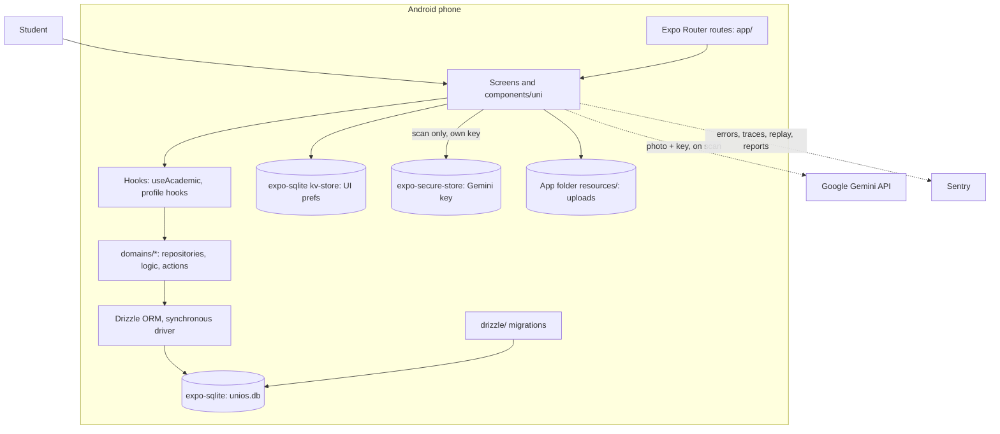
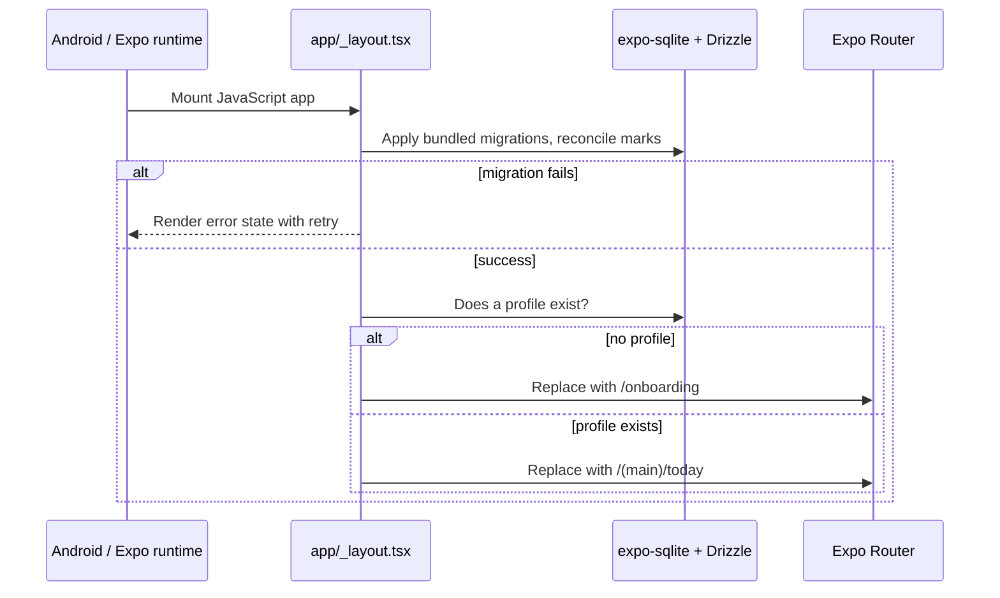
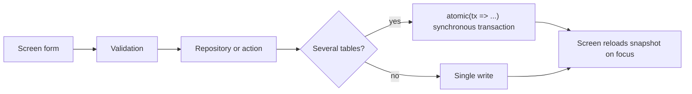

# UniOS Architecture

**Status:** Reconciled with the code on 2026-10-17, from commit `b779d2d`. UniOS is an Android app with all academic data on the phone. It has two external services: the optional Google Gemini timetable scan and Sentry error reporting. The laptop AI companion was removed in commit `8b38196` (2026-10-14). See [Source of Truth](../SOURCE_OF_TRUTH.md) for authority and change control.

## Architectural goals

1. Keep academic planning, attendance and materials usable with no internet connection.
2. Store the student's data on the phone.
3. Make failures visible and recoverable, never a crash or an endless spinner.
4. Send data off the phone only through the two services below, and disclose both.
5. Keep product, data and technical contracts separate, so the code stays maintainable.

## Component view



## Mobile layers

| Layer | Responsibility | Location |
| --- | --- | --- |
| Startup | Runs migrations and `reconcileAllMarks`, checks for a profile, routes to onboarding or Today. | `app/_layout.tsx`, `core/db/coordinator.ts` |
| Presentation | Screens and the design system. | `app/**`, `components/uni/**`, `components/files/**` |
| Read model | Loads all academic data in one pass. Reloads when a screen regains focus. | `domains/academic/snapshot.ts`, `domains/academic/hooks.ts` |
| Pure logic | Attendance maths, dates, alerts, queues. | `domains/academic/logic.ts`, `domains/academic/derive.ts` |
| Writes | Repositories and actions. Cross-table writes run in one synchronous `atomic()` transaction. | `domains/*/repository.ts`, `domains/academic/actions.ts`, `core/db/atomic.ts` |
| Schedule | Effective schedule from weekly slots, day rules and exceptions; keeps marks consistent. | `domains/calendar/` |
| Data model | Drizzle table declarations. | `domains/*/model.ts`, `core/db/schema.ts` |
| Persistence | Opens `unios.db` with foreign keys on. | `core/db/client.ts`, `drizzle/**` |
| Files | Stores uploads under bare names in `resources/`; reads office files with size limits. | `core/fs/`, `domains/resource/` |
| Backup | Exports and restores database rows as one JSON file. Uploaded files are not included. | `core/db/backup.ts`, `core/db/backupSchema.ts` |
| AI scan | Sends a timetable photo to Gemini and validates the reply. | `core/ai/timetableParser.ts`, `core/ai/geminiModels.ts`, `domains/timetable/scan.ts` |
| Diagnostics | Log buffer, bug report, Sentry feedback. | `core/diagnostics/` |

There is no server of its own and no cloud sync.

## Startup flow



Startup rules:

- A release APK embeds its JavaScript bundle. A development build loads it from Metro, so it shows "Unable to load script" without Metro.
- Startup must end in a rendered screen or an error state, never an endless splash.
- Startup must not insert sample academic data.

## Write flow



The expo driver commits when the callback returns. So a transaction must be synchronous: `db.transaction(async …)` does not roll back. See `AGENTS.md`.

## AI timetable scan

The scan is optional. The student can always set up the week by hand.

```mermaid
sequenceDiagram
    participant S as Student
    participant App as UniOS
    participant Store as expo-secure-store
    participant G as Google Gemini API

    S->>App: Save a Gemini key (Gemini key screen)
    App->>G: models.list with the key (key check)
    G-->>App: Accepted or rejected
    App->>Store: Save the key on the phone
    S->>App: Pick or take a timetable photo, tap scan
    App->>Store: Read the key
    App->>App: Read the photo as base64
    App->>G: generateContent: instruction text, section and group, photo
    opt every built-in model name is unavailable
        App->>G: models.list, then generateContent with a listed model
    end
    G-->>App: JSON classes
    App->>App: Validate (readScan); filter by group
    App-->>S: Review cards. Nothing is saved yet
    S->>App: Confirm
    App->>App: Save courses and weekly classes in SQLite
```

| Question | Answer | Evidence |
| --- | --- | --- |
| What leaves the phone? | The photo, the instruction text, the section and group names, and the API key. | `scanTimetable` in `core/ai/timetableParser.ts` |
| When? | When the student taps scan, and when they check a new key. Never in the background. | `app/course/ai-setup.tsx`, `app/settings/gemini-key.tsx` |
| Where is the key? | `expo-secure-store`, under `unios_ai_key_gemini`. Not in SQLite, backups or the report. | `core/settings/aiProviders.ts` |
| Who pays and whose terms apply? | The student's own Google account and key. Google's Gemini API terms apply. On the free tier, Google may use inputs to improve its products, and human reviewers may read them. | <https://ai.google.dev/terms> |
| What if the reply is bad? | `readScan` rejects malformed data; an empty result raises `UnreadableTimetable`. The screen offers retry or setup by hand. | `domains/timetable/scan.ts`, `__tests__/timetable_scan.test.ts` |

## Sentry

`Sentry.init` runs at import time in `app/_layout.tsx`, in every build variant.

| Setting | Value |
| --- | --- |
| `sendDefaultPii` | `false` |
| `environment` | `development`, `preview` or `production` (from `APP_VARIANT`) |
| `tracesSampleRate` | `1.0` in development, `0.2` otherwise |
| `replaysSessionSampleRate` | `0.1` |
| `replaysOnErrorSampleRate` | `1.0` |
| Replay masking | SDK defaults in `@sentry/react-native` 7.11.0: `maskAllText`, `maskAllImages` and `maskAllVectors` are `true` (`node_modules/@sentry/react-native/dist/js/replay/mobilereplay.js`) |

**Report a problem** (`core/diagnostics/index.ts`) sends the student's note, an optional email, app and device details, table row counts, and recent console warnings and errors. It does not read row contents. There is no setting to turn Sentry off. This is an open owner decision (PRD section 6).

## Data classification

| Data | Location | Leaves the phone? |
| --- | --- | --- |
| Profile, courses, schedule, attendance, tasks, notes | SQLite `unios.db` | Only in a backup file that the student exports |
| Uploaded files | App folder `resources/` | Only when the student shares or opens them in another app |
| Gemini key | `expo-secure-store` | Sent to Google with each scan or key check |
| Timetable photo during a scan | Read from the picker | Sent to Google when the student scans |
| Errors, traces, session replay, reports | Memory, then Sentry | Yes, to Sentry |
| UI preferences | `expo-sqlite/kv-store` (`unios.` prefix) | No |

## Untrusted input

Backups are shared between students. Deep links can come from other apps. Office files can be hostile. The rules are in `AGENTS.md` ("Untrusted paths and links"):

- Only names from `core/fs/names.ts` reach a file operation.
- Links must pass `isWebLink` or `isAppRoute`.
- Restores clear any other value (`sanitizeRestoredValues`).
- Office readers have size limits and do not expand XML entities (`domains/resource/office.ts`).

## Failure behaviour

| Condition | Behaviour |
| --- | --- |
| Migration failure | Error state with retry |
| Missing or invalid route parameter | Empty or not-found state |
| File pick or open failure | Message and retry; the form keeps its state |
| Database write failure | No false success; error message |
| Gemini error (no key, rejected key, quota, unreadable photo, network) | Named error card with next steps (`scanErrorKind`) |

## Deployment

| Target | Component | Notes |
| --- | --- | --- |
| Android phone | Standalone APK (`npm run build:preview`) | Bundled JavaScript; starts without Metro |
| Android phone, development | "UniOS Dev" dev client (`npm run build:dev`) | Loads JavaScript from Metro (`npm run dev`) |
| CI | GitHub Actions, `npm run check` | `.github/workflows/check.yml` |

Expo Go and web are not supported targets.

## Decision log

| Decision | Status | Reason |
| --- | --- | --- |
| Phone-local SQLite is the main data store | Implemented | Works offline; the student controls the data. |
| Drizzle migrations evolve the schema | Implemented | Explicit, versioned changes. |
| No sample data on a fresh install | Implemented | Sample data misleads. |
| Synchronous `atomic()` transactions | Implemented | The expo driver commits when the callback returns. |
| Optional Gemini scan with the student's own key | Implemented | Fast setup from a printed timetable. Manual setup stays available. |
| Sentry error reporting, always on | Implemented, owner review open | Added in `a09d221` ("integrate Sentry error monitoring and performance tracking"). Conflicts with the earlier "no telemetry" goal. |
| Laptop-local AI tutor | Removed (`8b38196`) | The commit message records that the tutor chain was never reachable from the app. |
| Full model fine-tuning for personalisation | Rejected | Not needed for the current scope. |
